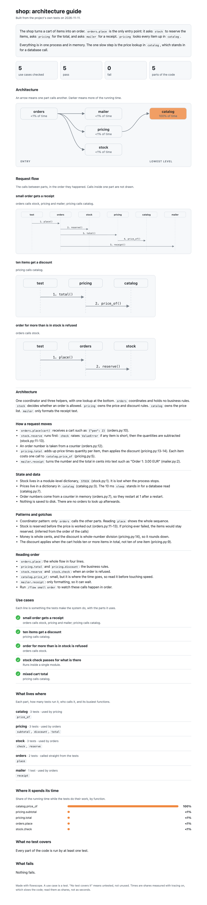

# flowscope

**Run `/explain` in a Python project. Get a one-page explanation of how it works, made from your tests.**

It runs your tests with a tracer, sees which parts of the code each one uses and where the time
goes, and writes one HTML page you can open offline, mail or print to PDF.



## Use it

```bash
claude plugin marketplace add vishalbanwari26/flowscope
claude plugin install flowscope@flowscope
```

Then, inside a Python project that has pytest tests:

| Type | For | You get |
|---|---|---|
| `/explain` | people who do not read code | what the system does, where it is slow, what no test covers |
| `/explain learn` | an engineer learning the system | architecture, request flow, where state lives, a reading order |
| `/explain interview` | presenting your own project | components, design decisions, bottlenecks, questions to expect |

No tests? `/addtests` writes some first.

## Examples

Made from the five tests in [`examples/shop`](examples/shop). Download a page and open it:

- [stakeholders.html](examples/shop/explain-output/stakeholders.html)
- [learn.html](examples/shop/explain-output/learn.html)
- [interview.html](examples/shop/explain-output/interview.html)

## What to know

- The tests show what ran and for how long. They do not show why you built it that way. For `learn`
  and `interview`, `/explain` reads your code, cites `file:line`, marks guesses `(inferred)`, and
  asks you the "why" questions. Read the page before you send it.
- It runs your tests in place. Start from a clean git tree.
- Nothing leaves your machine.
- Python and pytest only. Early: tried on five projects, Python 3.12.

More: [every command, the viewer, and how it works](docs/reference.md).

MIT
