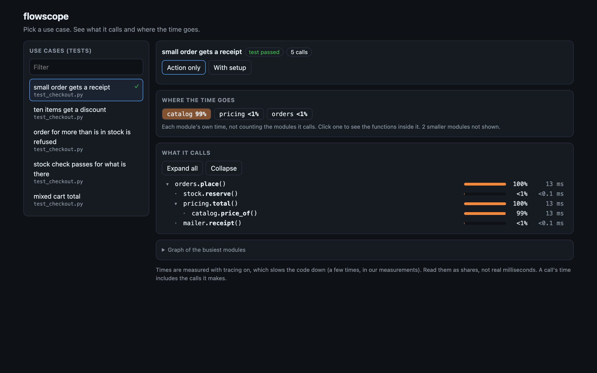
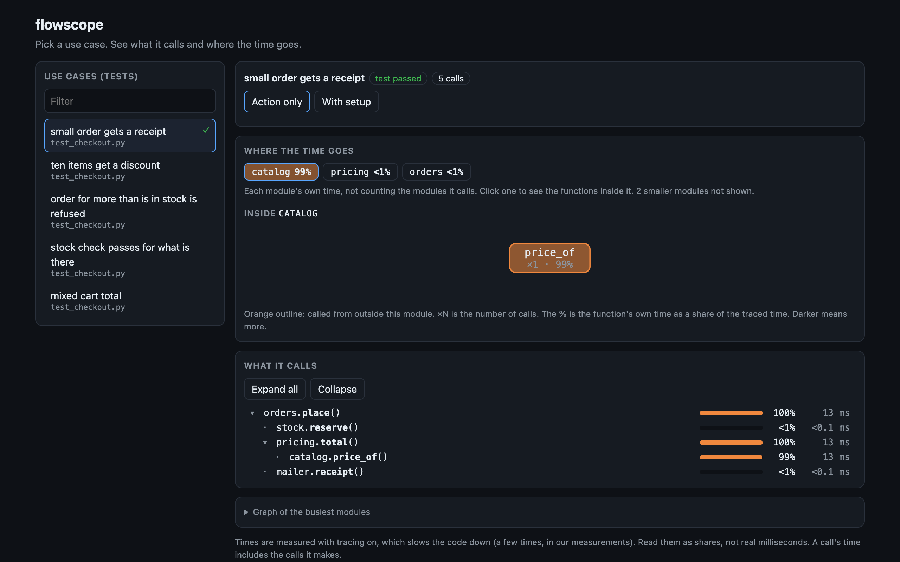
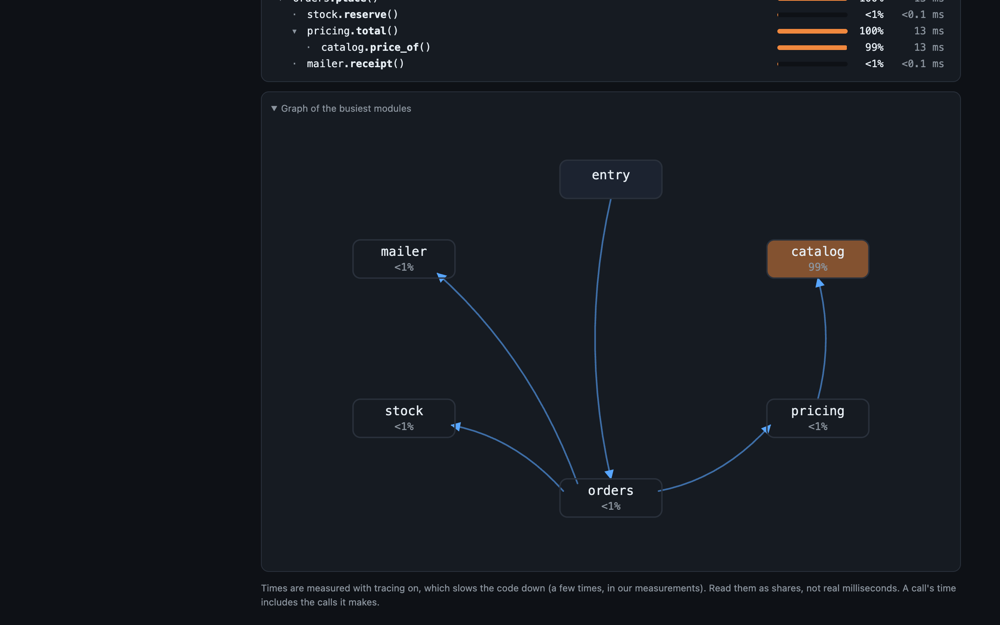

# flowscope reference

`/explain` is built from these. Each answers one question and works on its own.

### Trace one test

The example is [`examples/shop`](../examples/shop): a tiny checkout with four modules and five tests.
One call, `catalog.price_of`, pretends to be a database lookup and is slow. The three commands
below find it without anyone reading the code.


The viewer shows the same test. Each module's share of the time is a chip, and the call tree
shows which call made which.



Click a chip to see the functions inside that module.



Under the call tree there is a graph of the busiest modules, closed by default because it gets
crowded on big projects. Each arrow is one module calling another. `entry` is the test itself.
The darker the box, the bigger its share of the time.



Try it yourself:

```bash
cd examples/shop
../../bin/flow hld
../../bin/flow run "small order"
../../bin/flow bottleneck
```

### The commands

In a Python project that has pytest tests:

| Command | It answers | You get |
|---|---|---|
| `/hld` | What is this project made of? Which modules do the tests reach? | A ranked list of modules and the main links between them |
| `/lld <module>` | What runs inside this module? | The functions that ran, how often, and who called them |
| `/flow <test>` | What does this test run? | A short call tree with time shares |
| `/scope <name>` | Which tests reach this module or function? | A list of tests, with pass or fail |
| `/debug [test]` | Why does it fail? | The error, and the last calls before it stopped. With no test, every failing test and its reason |
| `/findbottleneck [test]` | Where does the time go? | The functions that take most of it, or one test's heaviest path |
| `/addtests [target]` | There are no tests, or this part has none | Claude writes one small test per use case, entry points first, and shows each one's flow |
| `/flowscope` | Show me | Opens the viewer in your browser |

`/hld`, `/lld`, `/scope`, `/debug` and `/findbottleneck` with no test need every test run once.
The first one does that and says so. The result is saved, so the next one is instant. It is
rebuilt when you edit a Python file.

Nothing is installed in your project. flowscope runs with the project's own Python (`.venv`,
`venv`, a uv project, or `python3`) and is read from the plugin folder. To use a different
Python, set `FLOWSCOPE_PYTHON`. The launcher is a bash script, so macOS and Linux.

### Use them without Claude Code

```bash
cd your-project
/path/to/flowscope/bin/flow                    # open the viewer
/path/to/flowscope/bin/flow hld                # the same commands, without the slash
/path/to/flowscope/bin/flow run "some test"
```

Or install it into the project's environment and call `flowscope` directly:

```bash
pip install /path/to/flowscope
flowscope serve | list | run | hld | lld | scope | debug | bottleneck | gaps | brief
```

`flowscope run "some test" --depth 5` prints more levels. `--setup` includes setup calls.
`--fresh` on the project-wide commands ignores the saved result.

### The viewer

Pick a test on the left. On the right, from top to bottom:

- **Where the time goes.** A few chips, one per busy module, shaded by its share of the time.
  Click one to see the functions inside it.
- **What it calls.** A tree: each call sits under the call that made it. Repeated calls are
  merged ("x15"). Only the branches that hold the time are open; click the rest.
- **A graph** of the busiest modules, closed by default.

## How it decides what is setup

A test spends most of its calls building data. Those are hidden by default, so you see what the
test is about. It judges by the function called, not by who called it, because a test helper
often builds data and runs the code under test in the same function.

| The call is | Counts as |
|---|---|
| made during a pytest fixture | setup |
| a constructor (`__init__`) | setup |
| named like a builder: `add_*`, `set_*`, `seed*`, `generate*`, `create*`, `build*`, `make*`, `load*`, `reset*`, `insert*`, `populate*`, `register*`, `init*` | setup |
| anything else the test calls | action |
| made by a function that setup or action already called | the same as that function |

This is a guess. When it would hide every call a test makes, flowscope shows them instead and
says so: the test is probably about a constructor or a loader. "With setup" shows everything.

## About the times

The tracer runs on every function call, so it slows the code. On the one project where this was
measured, tests ran 1.3 to 4.3 times slower with tracing on, median 2.6. Functions that make many
calls look a little slower than they are. The first call in a test is also slower (start-up).
Read the times as shares of the total, not as real milliseconds.

A function's own time includes waiting on anything it calls outside the project: the disk, the
network, another program. A big share is a place to look, not proof of a problem.

## Safety

- **It runs your tests, in place.** A test that writes files will write them. Start from a clean
  git tree and check `git status` afterwards.
- **Localhost only.** The viewer's server listens on 127.0.0.1, checks the Host header, and needs
  the random token in the URL it prints. Without that, any web page open in your browser could ask
  it to run tests.
- It never sends anything over the network. The saved result is in `~/.cache/flowscope`
  (set `FLOWSCOPE_CACHE` to move it) and holds test and function names and timings.

## Limits

- `/explain` describes what the tests run. It does not know your design decisions, load or scale, or code no test runs. Do not present the page as a full architecture review.
- Python (pytest) and JavaScript/TypeScript (Jest). A project with no tests has no use cases: `/addtests` helps write some.
- `gaps` (behind `/addtests`) reads the source. It lists top-level functions and class methods, not nested ones.
- A module is a file. Two files with the same name get a longer name.
- Function level, not line level.
- It only shows what the tests run. "No test reaches it" means untested, not unused.
- Code that runs in other processes is not seen.
- The viewer runs every test in one server process, so module state carries over between runs. A test that relies on leftover state (a counter, a cache) can pass the first time and fail the second. `flow run` starts a fresh process each time.
- Calls made by library code that the project's own functions never touch are not shown.

## Develop

```bash
uv venv && uv pip install -e . pytest
.venv/bin/python -m pytest
```

If `import flowscope` fails on macOS after an editable install, the venv's `.pth` files may have
the macOS `hidden` flag, which Python skips. `chflags -R nohidden .venv` clears it. The tests do
not depend on the editable install.

## License

MIT

## JavaScript and TypeScript

`hld`, `lld`, `scope`, `debug`, `bottleneck`, `gaps`, `brief` and `/explain` work on projects that
test with Jest or Vitest. Your own test configuration is still used; flowscope only adds a
transform and a setup file. Both record, per test, which module called which and for how long.

- **Jest:** a Babel plugin wraps each named function of your own files (not `node_modules`, not test
  files). Needs `npm install` done, and either a Babel setup (`babel.config.js`) or
  `@babel/preset-env` plus `@babel/preset-typescript` installed so flowscope can read the code.
- **Vitest:** a Vite plugin does the same to the JavaScript Vite has already made from your
  TypeScript, so it needs no Babel. It switches on Vitest's `globals` for the run and adds a setup file.

What is different from Python:
- No per-test view yet: `flow run`, `/flow` and the viewer say so. The project-wide commands work.
- A function is only recorded if it has a name (a `const f = () => ...`, a method, a declaration).
  An anonymous callback counts under the function around it.
- Jest: `beforeEach` and `afterEach` hooks count as setup. Vitest: they do not, because the hooks are
  imported from `vitest`. Builder-like names (`create*`, `seed*`, ...) and constructors count as setup
  in both, as in Python.
- Async functions are recorded, but their time includes the waiting.
- Jest: only the first project is read when the config lists several. Vitest workspaces are not handled.
- `gaps` lists exported functions and class methods; if a file has no exports it lists top-level ones.
  It reads the code with `@babel/parser` if the project has it, else TypeScript, else Node's type
  stripper with Vite's parser (Node 22.13 or newer).
